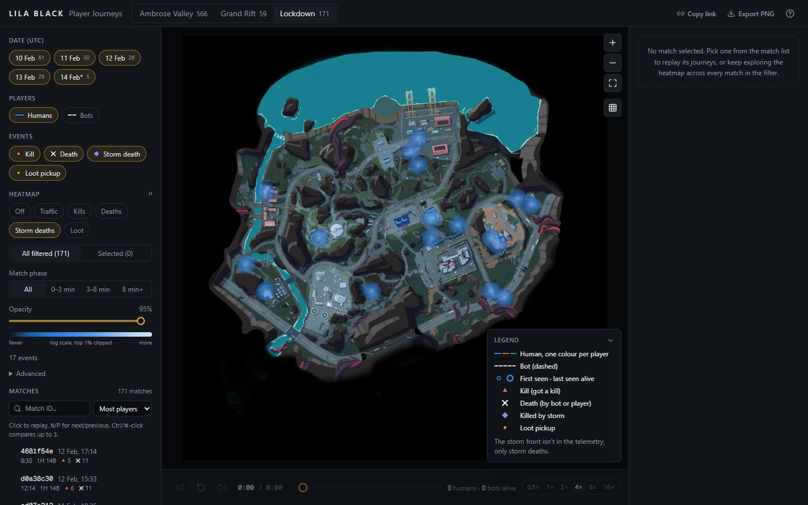
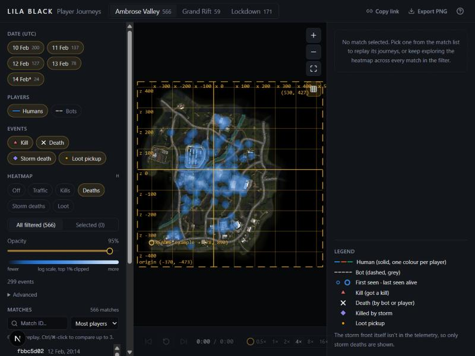
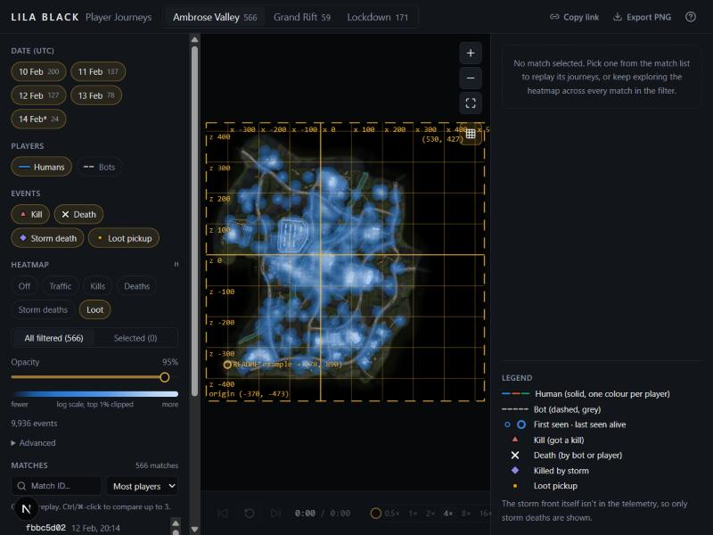
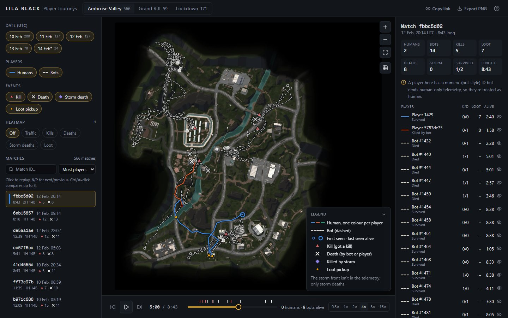

# Insights: what the telemetry says about LILA BLACK's maps

Three findings from the tool, covering 798 human runs across 796 matches (10–14 Feb 2026). Every
number can be reproduced with `python scripts/insights.py`, and every image is a screenshot of the
tool itself. Zone coordinates are world `(x, z)` and can be checked with the calibration grid
(press **G**). Each "Open … view" link reopens that exact view in the
[live tool](https://lila-player-journeys-peach.vercel.app).

---

## 1. On Lockdown and Grand Rift, the storm is the main late-game killer

**What caught my eye.** With the Storm deaths heatmap on Lockdown, the 17 storm deaths are spread
across the whole map, not bunched at one bottleneck. That pointed to a timing problem rather than
a route problem, so I compared how runs end once a match gets long.

**Evidence.**

| Map            | Human runs | Storm deaths (share of runs) | Runs alive at 10:00 | …of those, killed by storm |
| -------------- | ---------: | ---------------------------: | ------------------: | -------------------------: |
| Ambrose Valley |        568 |                    17 (3.0%) |                 130 |                  **13.1%** |
| Grand Rift     |         59 |                     5 (8.5%) |                  14 |                  **35.7%** |
| Lockdown       |        171 |                    17 (9.9%) |                  44 |                  **38.6%** |

- Every storm death on every map happens between **10:55 and 14:47** of match time. The storm
  only kills late.
- A Lockdown player still alive at 10 minutes is about **3× more likely** to die to the storm than
  one on Ambrose Valley. Only 52% of them get out, against 75% on Ambrose Valley.
- Storm deaths on Lockdown don't share a location (see the screenshot), so no single route or
  piece of cover is to blame.

_Lockdown · Heatmap: Storm deaths · Players: Humans · all 171 matches._
[Open this view in the tool](https://lila-player-journeys-peach.vercel.app/?map=Lockdown&match=none&players=human&heat=storm&opacity=0.95&bin=16)

**What to do.**

1. Bring Lockdown's (and Grand Rift's) final storm push in line with Ambrose Valley. That means
   either about 60 s more before the last phase, or an extraction point reachable from the far side
   of the map late in the match.
2. Log the storm itself (phase start, direction, front position). Right now the tool can show
   _where_ players died to the storm but not _where the storm was_, which is the missing half of
   this analysis.

**Metrics that should move:** storm deaths as a share of runs (Lockdown 9.9% → toward Ambrose
Valley's 3%), extraction rate among runs alive at 10:00 (52% → 70%+), and late-match churn, since
a storm death after 12 minutes of looting is the most frustrating way to lose a run.

**Why a Level Designer should care.** The storm is the map's pacing device. If it kills four in ten
players who play long on Lockdown, the map is punishing exactly the thorough, loot-everything
behaviour an extraction shooter wants. Because the deaths are spread across the map, this is fixed
with extraction placement and storm timing, not with cover.

---

## 2. Loot risk is badly uneven: some zones are free, others cost 3× the map average

**What caught my eye.** Switching between the **Loot** and **Deaths** heatmaps on Ambrose Valley,
loot covers almost the whole island. Deaths, though, pile up in the central band and nearly vanish
in the southern compounds.

**Evidence.** Deaths per 100 loot pickups, human runs only, in 56×56-unit zones with at least 40
pickups:

| Map / zone (world x, z)                                    |        Pickups | Deaths | Deaths per 100 pickups |
| ---------------------------------------------------------- | -------------: | -----: | ---------------------: |
| **Ambrose Valley average**                                 |          9,936 |    316 |                **3.2** |
| AV central-west band (x −89…80, z −135…146), four zones    |            314 |     32 |    **10.2** (3.2× avg) |
| AV southern compounds (x −89…249, z −360…−192), four zones | 293 (125 runs) |      0 |                **0.0** |
| **Lockdown average**                                       |          2,050 |     97 |                **4.7** |
| LD east-centre compound (x 63…125, z −63…0)                |            101 |     12 |    **11.9** (2.5× avg) |
| LD west riverside (x −313…−250, z −125…−63)                |            156 |      1 |                **0.6** |

_Ambrose Valley, humans only, calibration grid on. Deaths (top) sit in the central band. Loot
(bottom) also covers the southern compounds (z < −190), where nobody died in 5 days._
[Open the deaths view](https://lila-player-journeys-peach.vercel.app/?match=none&players=human&heat=deaths&opacity=0.95&bin=16&grid=1) ·
[Open the loot view](https://lila-player-journeys-peach.vercel.app/?match=none&players=human&heat=loot&opacity=0.95&bin=16&grid=1)

**What to do.**

1. Add threat to the free zones: a bot patrol or spawn covering the Ambrose Valley southern
   compounds and the Lockdown west riverside. Or thin their loot so they stop being the
   optimal low-risk route.
2. Make the high-risk zones pay for themselves. If the AV central band and the LD east-centre
   compound are meant to be "hot" POIs, their loot quality should be visibly better. Today they
   yield the same pickups at three times the risk.
3. Re-run this table after the change. It's one script.

**Metrics that should move:** spread of deaths-per-pickup across zones (today 0 to 11.9 per 100,
target a narrower band), share of runs that visit the central band, and loot per surviving run.

**Why a Level Designer should care.** Risk and reward are the core loop of an extraction map. A
zone with 122 pickups across 53 runs and zero deaths is a solved route: experienced players will
farm it and skip the rest of the map. Caveat: each zone's death count is small (0–12), so read this
as direction, not a precise rate.

---

## 3. Every map is currently a PvE map: zero player-vs-player kills in 5 days

**What caught my eye.** The match panel never showed a "Killed by player" outcome. The only `Kill`
and `Killed` rows in the whole dataset turned out to be the same player killing themselves in the
same second.

**Evidence.**

- **798 human runs, 0 human-vs-human kills.** The 3 `Kill`/`Killed` pairs are self-eliminations
  (same file, same second, same coordinates).
- Human combat is entirely against bots: **2,238 bot kills** and **401 deaths to bots**, plus 39
  to the storm.
- **794 of 796 matches** contain telemetry for exactly one human.

_The busiest match in the dataset (`fbbc5d02`): two humans with telemetry, 14 bots, and every
death caused by a bot._

**What to do.** This is either a property of the game or a property of the export, and the fix
depends on which:

- **If matches really are one human vs bots** (low concurrency, or matchmaking backfilling with
  bots): PvP spaces such as chokepoints and contested POIs can't be validated from live play yet.
  Bot spawn and patrol placement is the lever that shapes every combat heatmap in this tool, and
  should be tuned as level design.
- **If the export only includes one player per match**: add lobby size and the full roster to the
  telemetry. Without it, no PvP analysis is possible, however good the tool.

**Metrics:** PvP encounters per match (currently 0), humans per lobby (needs logging), and the
bot share of human deaths (100% of non-storm, non-self deaths today).

**Why a Level Designer should care.** Every "kill zone" in this data is a **bot** kill zone. It
shows where bots are placed and how they path, not where player sightlines create fights. Before
moving cover or doors to shape PvP, confirm that PvP is actually happening. Otherwise the map gets
tuned against the AI rather than against players.
