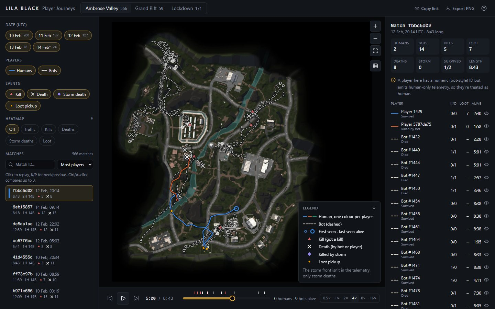
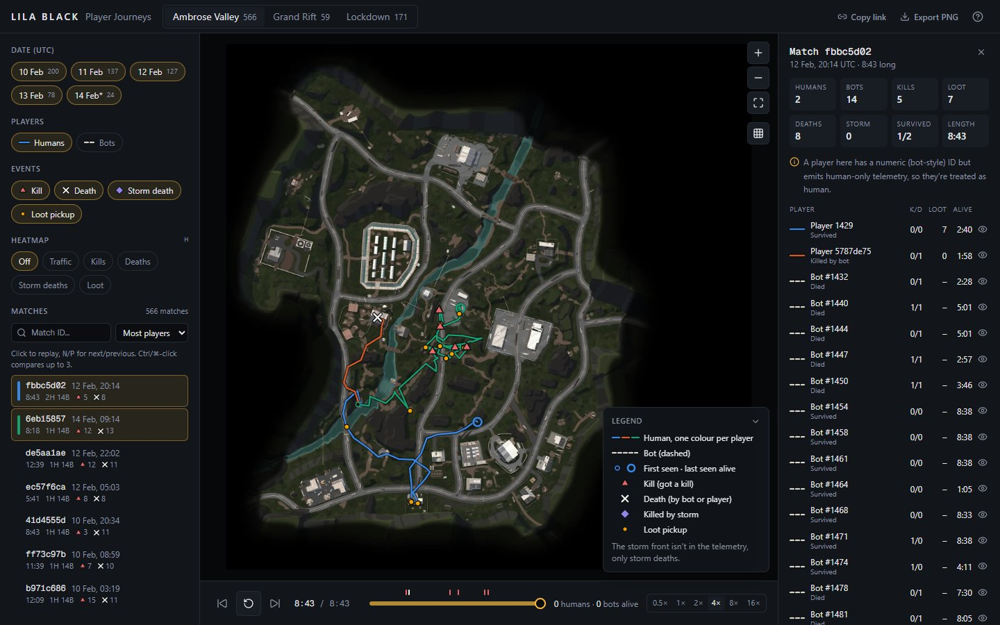
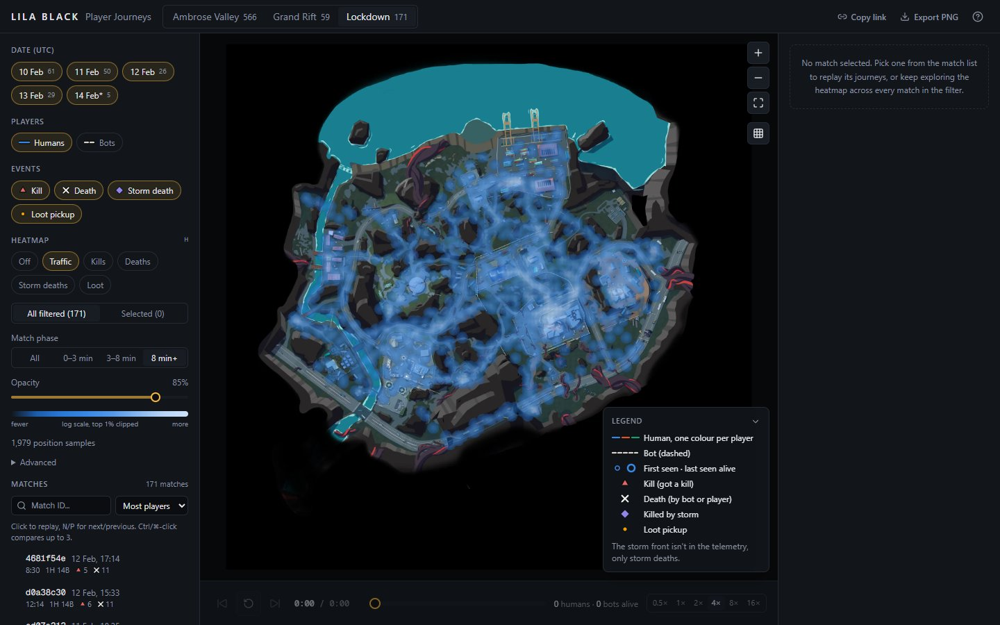
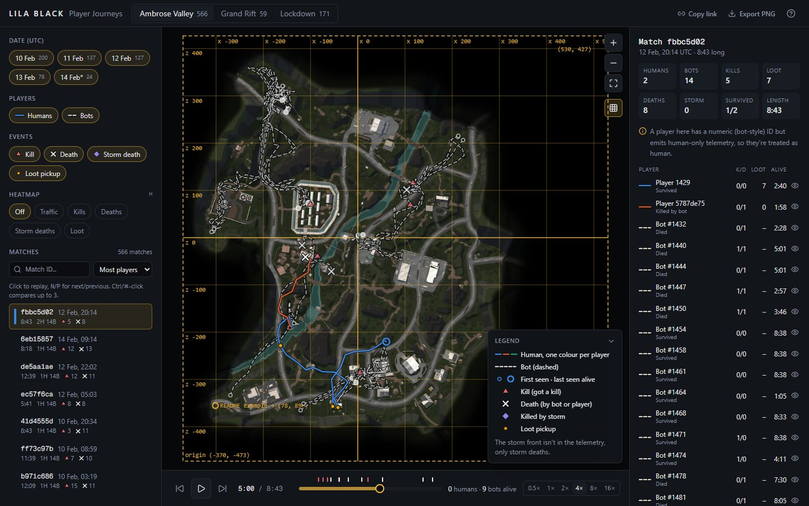
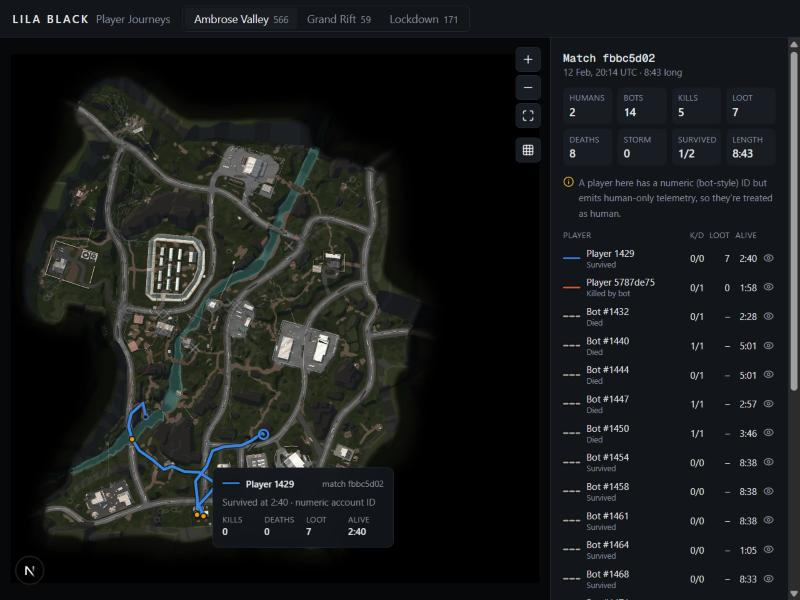
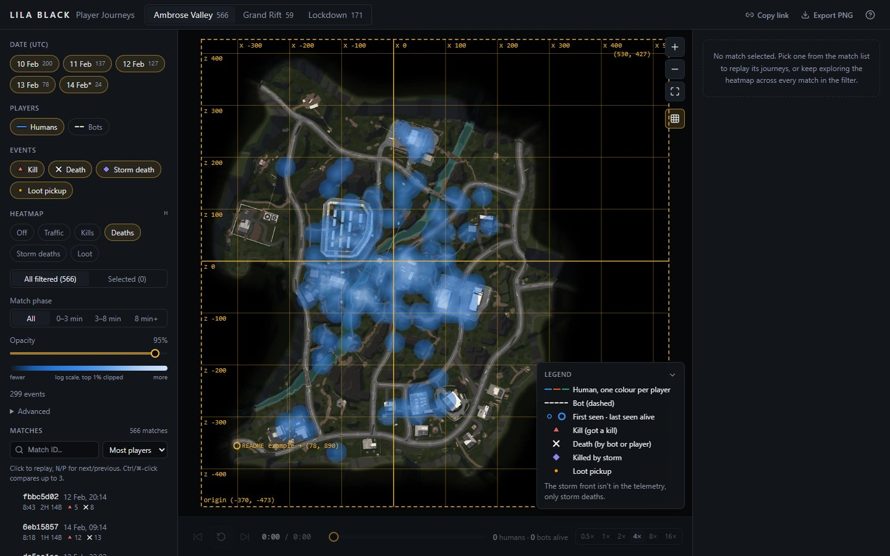
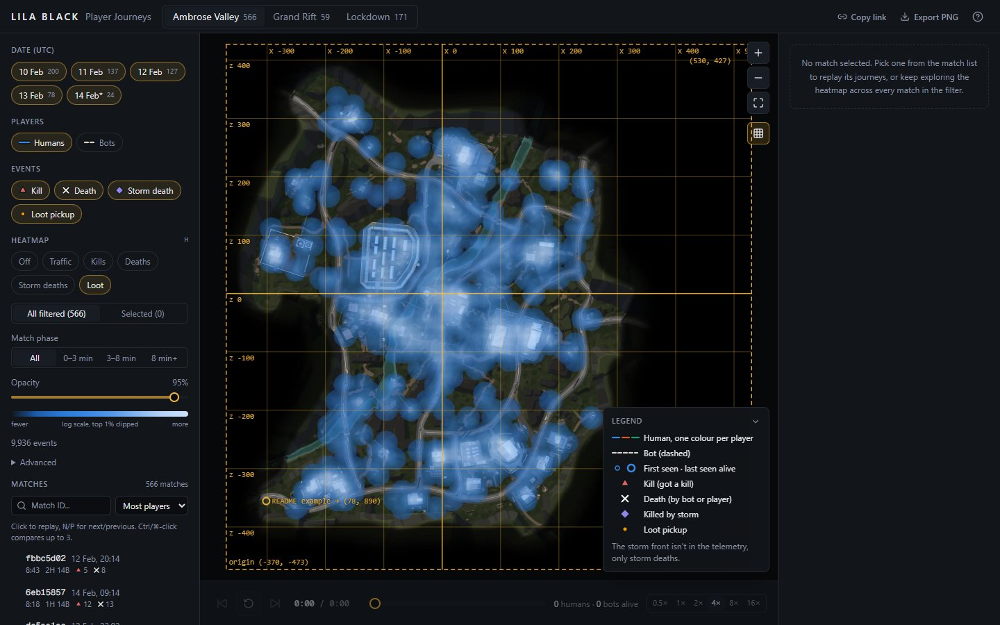

# LILA BLACK · Player Journeys

**Live tool: https://lila-player-journeys-peach.vercel.app**. No login, desktop browser
recommended. Press `?` in the app for a quick guide.

A browser tool for Level Designers to see how players actually move through LILA BLACK's maps.
It covers 5 days of production telemetry (796 matches, 89k events) drawn on the real minimaps. You
can replay any match second by second, see where people loot, fight and die to the storm, and
switch on heatmaps across every match in a filter. Every view is a URL, so a finding can be shared
in Slack as a single link.



- **[INSIGHTS.md](INSIGHTS.md)**: three findings from the data, with evidence and actions.
- **[ARCHITECTURE.md](ARCHITECTURE.md)**: stack, data flow, the coordinate mapping, assumptions
  and tradeoffs.
- **[docs/data-notes.md](docs/data-notes.md)**: full data inventory, including where the shipped
  README is wrong.

## Features

|                      |                                                                                                                                                                                                                                                                              |
| -------------------- | ---------------------------------------------------------------------------------------------------------------------------------------------------------------------------------------------------------------------------------------------------------------------------- |
| **Map view**         | Correct minimap per map. Wheel/pinch zoom around the cursor, drag to pan, reset. Sharp at deep zoom (4096 px tiles load on demand)                                                                                                                                           |
| **Player journeys**  | Humans are solid lines in validated colour-blind-safe colours. Bots are dashed grey underneath. Spawn dots and a "last seen alive" ring for survivors. Hover (or tap) a path for the player card (outcome, K/D, loot, time alive). A collapsible legend sits on the map      |
| **Event markers**    | Kill ▲, death ✕, storm death ◆ and loot ● use shape _and_ colour. Constant on-screen size at any zoom. Hover for a plain-language description, click to jump playback to that moment                                                                                         |
| **Filters**          | Map, date (UTC, Feb 14 flagged partial), humans/bots, event types. Match list with ID search and sorting. Ctrl/⌘-click to compare up to 3 matches                                                                                                                            |
| **Timeline**         | Play/pause, scrub, 0.5×–16×, colour-coded combat ticks on the track (click one to jump to that moment), live count of who's alive. Paths grow and markers appear as the match unfolds                                                                                        |
| **Heatmaps**         | Traffic, kills, deaths, storm deaths and loot, across all filtered matches or only the selected ones. Slice by match phase (0–3 min, 3–8 min, 8 min+) to separate the opening drop from the extraction and storm endgame. Opacity, bin size and a log-scaled single-hue ramp |
| **Match panel**      | Start time, length, humans/bots, event totals and survivors. Per-player table: click a player to zoom the map to their whole path, hover to highlight it, toggle to hide it. Notes on data quirks                                                                            |
| **Calibration grid** | World-space grid, axes and the README worked example, drawn through the same transform as the data, with a cursor readout of world coordinates                                                                                                                               |
| **Share & export**   | The URL holds every setting, including playback time. Copy link (L) and export the current view as PNG (E)                                                                                                                                                                   |

| Compare matches (Ctrl/⌘-click)                             | Heatmap sliced to the endgame (8 min+)                 |
| ---------------------------------------------------------- | ------------------------------------------------------ |
|            |  |
| **Calibration grid**                                       | **Hover card**                                         |
|  |          |
| **Deaths heatmap**                                         | **Loot heatmap**                                       |
|      |      |

### Keyboard shortcuts

| Key          | Action                    |
| ------------ | ------------------------- |
| `Space`      | Play / pause              |
| `←` `→`      | Step 5 s (`Shift` = 30 s) |
| `Home` `End` | Start / end of match      |
| `[` `]`      | Slower / faster           |
| `N` `P`      | Next / previous match     |
| `H`          | Cycle heatmap layer       |
| `G`          | Calibration grid          |
| `+` `−` `0`  | Zoom in / out / reset     |
| `E`          | Export PNG                |
| `L`          | Copy link to this view    |
| `?`          | Help                      |

### Performance

Lighthouse (desktop): **Accessibility 100 · Best Practices 100 · SEO 100**. Performance scores
**98** on a local production build and **88–92** on the live Vercel URL, where it varies with the
network. The first view needs about 350 KB (manifest, one match, a 2048 px minimap).
Heatmap points load only when a heatmap is switched on, and the match list renders rows in pages
as you scroll.

## Tech stack

Next.js 15 (App Router) · TypeScript · Konva (react-konva) · Tailwind CSS v4 · Radix UI ·
TanStack Query · Zustand · Vitest. The data pipeline is Python with DuckDB, pandas and Pillow.
Hosted on Vercel with CI on GitHub Actions. Reasons for each choice are in
[ARCHITECTURE.md](ARCHITECTURE.md).

## Run it locally

Requires Node 20+ and pnpm.

```bash
pnpm install
pnpm dev            # http://localhost:3000
```

The processed data is committed in `public/data/`, so nothing else is needed to run the app.

**Environment variables: none.** The app is fully static and reads its data from `/data`.

### Rebuilding the data (optional)

Requires Python 3.11+. Unzip `player_data.zip` into `data/raw/` (git-ignored) so that
`data/raw/player_data/February_10/…` exists, then:

```bash
python -m venv .venv && source .venv/bin/activate   # Windows: .venv\Scripts\activate
pip install -r scripts/requirements.txt
pnpm preprocess                 # → public/data/ (about 40 s)
python scripts/insights.py      # reprints every number in INSIGHTS.md
```

### Checks

```bash
pnpm lint && pnpm typecheck && pnpm format:check && pnpm test && pnpm build
```

CI runs the same steps on every push and pull request.

## Project layout

```
scripts/preprocess.py     parquet → public/data (cleaning rules documented inline)
scripts/insights.py       reproducible numbers behind INSIGHTS.md
src/lib/coords.ts         worldToMinimap / minimapToWorld (+ tests)
src/lib/scene.ts          shards → drawable journeys and events (+ tests)
src/lib/heatmap.ts        binning and rendering (+ tests)
src/lib/url-state.ts      shareable view state ⇄ query string (+ tests)
src/components/map/       Konva canvas and layers
src/components/explorer/  sidebar, match panel, timeline, dialogs
```

## Known limitations

- **No storm geometry.** The telemetry has no storm position or phase, so only storm deaths are
  drawn.
- **One human per match.** 794 of 796 matches carry telemetry for a single human, and bot paths
  exist for only 52 matches. Bot-traffic heatmaps reflect those 52.
- **"Survived" ≠ "extracted".** There is no extraction event. A run without a death could be either
  an extraction or a disconnect.
- **1-second timestamps.** Events within the same second are ordered as they appear in the file.
- **Desktop-first.** It works on phones and tablets (pinch zoom, touch scrubbing, Filters and
  Match drawers), but the full three-panel layout is meant for a laptop or larger.
